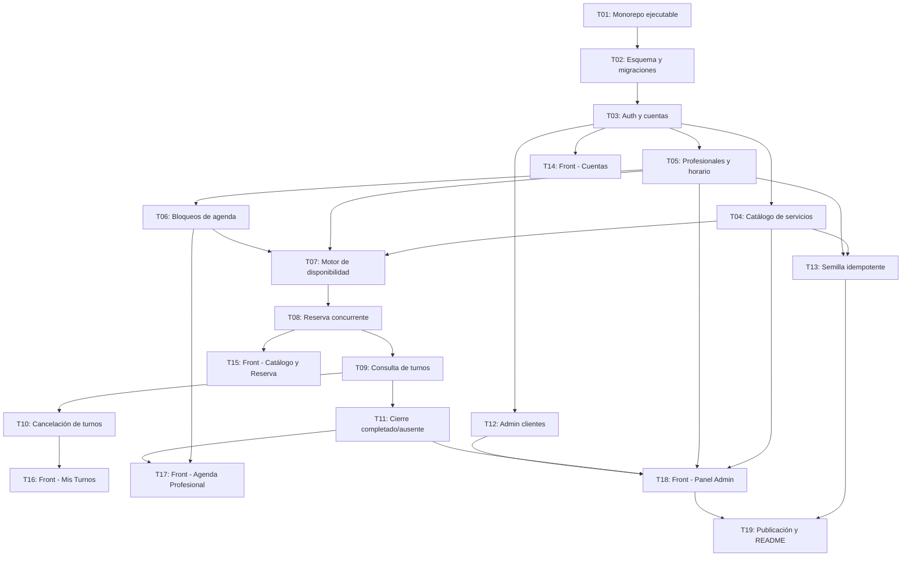

# Auditoría Inicial y Plan Técnico de Ejecución
**Proyecto:** Studio Capilar — Sistema de Gestión de Turnos  
**Rol:** Arquitecto de Software Senior & Tech Lead  
**Fecha:** 19 de Noviembre de 2026  
**Entorno de Auditoría:** Windows (PowerShell), Node.js v26.13.1, npm v11.20.0  

---

## 1. Resumen Ejecutivo

Se ha realizado una auditoría exhaustiva y no destructiva del repositorio `Estudio-Capilar`. El proyecto cuenta con una base documental y de diseño arquitectónico excepcionalmente sólida, coherente y detallada (`spec.md`, `decisiones.md`, `plan.md`, `idea.md`, `glosario.md`, `preguntas-abiertas.md`, `AGENTS.md` y `.cursor/`).

No obstante, **la aplicación se encuentra en estado inicial/esqueleto:**
- **Backend:** Implementado en un ~5% (únicamente configuración de arranque y endpoint `/api/health` en `app.ts`). Faltan migraciones SQL, módulos de negocio, middlewares, reloj inyectable y lógica de persistencia.
- **Frontend:** Implementado en un 0% (solo configuración de build y dependencias en `frontend/package.json`; no existen componentes, páginas, rutas ni `index.html`).
- **Base de Datos:** Sin esquema desplegado ni migraciones aplicadas.
- **Testing:** Existe únicamente 1 prueba de humo básica (`health.test.ts`). Ninguno de los 41 casos de prueba formales (`CP-01` a `CP-41`) ha sido implementado ni ejecutado.
- **Despliegue:** Inexistente por el momento (no hay infraestructura en Neon, Render ni Netlify).
- **Control de Versiones:** Estado anómalo detectado; el directorio del proyecto no posee un `.git` propio, sino que se enlaza accidentalmente al `.git` del directorio de usuario de Windows (`C:\Users\lauti`).

---

## 2. Diagnóstico del Entorno de Ejecución

1. **Node.js:** Versión `v26.13.1` instalada y compatible (requisito `>= 22` satisfecho).
2. **NPM & PowerShell:** La política de ejecución de scripts de Windows (`ExecutionPolicy Restricted`) bloquea la invocación directa de `npm` (que llama a `npm.ps1`). **Mitigación:** Todos los comandos de npm deben ejecutarse mediante `npm.cmd` o `cmd /c npm`.
3. **Docker:** No está instalado ni disponible en el host (`docker` no reconocido, WSL no instalado). **Mitigación:** El plan original contempla como alternativa el uso directo de PostgreSQL en la nube con Neon (`DATABASE_URL` y `DATABASE_URL_TEST`), lo cual además simplifica la paridad total con el entorno de despliegue final exigido.
4. **Git:** El comando `git status` revela que `C:\Users\lauti\.git` está activo sobre todo el perfil de usuario. `Estudio-Capilar` requiere una inicialización explícita (`git init`) para encapsular estrictamente los archivos del proyecto y evitar commits accidentales de archivos personales del sistema operativo.
5. **Dependencias:** Ni el monorepo raíz ni los subpaquetes (`backend`, `frontend`) tienen instalados los módulos (`node_modules` ausente).

---

## 3. Matriz de Cumplimiento de Requisitos

| Área / Requisito | Estado | Observaciones |
| :--- | :---: | :--- |
| **1. Documentación** | | |
| `idea.md` | Cumplido | Describe problema, actores, alcance v1 y fuera de alcance. |
| `decisiones.md` | Cumplido | Decisiones arquitectónicas cerradas D1 a D24. |
| `glosario.md` | Cumplido | Definición rigurosa de términos del dominio. |
| `preguntas-abiertas.md` | Cumplido | Delimita explícitamente lo excluido de la v1. |
| `spec.md` | Cumplido | 17 RNs, máquina de estados, contratos de API, HU-01 a HU-13 y CP-01 a CP-41. |
| `AGENTS.md` | Cumplido | Roles definidos, orden de lectura y definición de terminado. |
| Agentes y Reglas (`.cursor/`) | Cumplido | Agentes (`analista`, `arquitecto`, `backend`, `frontend`, `revisor`, `tester`) y reglas `.mdc`. |
| `plan.md` | Cumplido | DDL relacional, restricciones gist, capas y algoritmo de reserva/disponibilidad. |
| `tasks.md` | En progreso | 19 tareas definidas cronológicamente (T01 a T19), 0 completadas. |
| `README.md` | Parcial | Guía inicial redactada; pendiente actualizar con URLs públicas y verificación real. |
| **2. Reglas de Negocio (RN1 a RN17)** | Pendiente | Completamente especificadas, pendientes de codificación en backend y base de datos. |
| **3. Implementación** | | |
| Backend (Express + TS) | Parcial (~5%) | Solo `app.ts` básico con health check. Faltan los 5 módulos y middlewares. |
| Frontend (React + TS) | Pendiente (0%) | Falta `index.html`, contexto de auth, router, páginas y estilos. |
| Base de Datos (PostgreSQL) | Pendiente (0%) | Migración `001_init.sql` no creada; extensiones y constraints pendientes. |
| Pantallas (7 vistas) | Pendiente (0%) | Ninguna pantalla creada (`/`, `/registro`, `/ingreso`, `/reservar`, `/mis-turnos`, `/agenda`, `/admin`). |
| Autenticación & Autorización | Pendiente | Lógica de JWT, bcrypt y middlewares por rol pendientes. |
| Validaciones (Zod & front) | Pendiente | Esquemas de validación Zod no implementados aún. |
| Manejo de Errores | Pendiente | Formato estándar `{ error: { code, message } }` pendiente de middleware central. |
| **4. Calidad y Testing** | | |
| Vitest + Supertest | Parcial | Configuración lista. Solo 1 test implementado (`health.test.ts`). |
| Casos CP-01 a CP-41 | Pendiente (0/41) | Ningún caso de negocio implementado. |
| Regla de commits por tarea | Pendiente | Listo para aplicar una vez subsanado el entorno Git. |
| Ciclo Tester-Dev-Revisor | Pendiente | Se aplicará estrictamente por cada tarea T01-T19. |
| **5. Publicación** | | |
| PostgreSQL en Neon | Pendiente | Requiere aprovisionamiento de base de producción y test. |
| Backend en Render | Pendiente | Requiere repositorio remoto y variables de entorno configuradas. |
| Frontend en Netlify | Pendiente | Requiere build del frontend y variable `VITE_API_URL`. |
| CORS y variables de entorno | Parcial | `cors` configurado en `app.ts`; `.env.example` completo; `.env` pendiente. |
| **6. Informe Final** | En curso | Auditoría inicial generada en este informe; informe final se completará al cerrar T19. |

---

## 4. Problemas Potenciales y Riesgos Detectados

1. **Riesgo Crítico de Control de Versiones (Git Root Desalineado):**
   - *Hallazgo:* No existe `.git` en `C:\Users\lauti\Desktop\Estudio-Capilar`. Git reconoce `C:\Users\lauti\.git`.
   - *Impacto:* Cualquier commit no intencional intentaría versionar todo el disco de usuario (`NTUSER.DAT`, `.claude.json`, etc.).
   - *Acción correctiva:* Inicializar `git init` inmediatamente en `C:\Users\lauti\Desktop\Estudio-Capilar`, verificar `.gitignore`, configurar rama principal (`main`) y crear el commit inicial limpio antes de iniciar las tareas.

2. **Ejecución de Scripts en PowerShell (`npm.ps1` bloqueado):**
   - *Hallazgo:* `npm -v` falla por políticas de ejecución de scripts de Windows.
   - *Impacto:* Las tareas de compilación y testing fallarían en la consola predeterminada.
   - *Acción correctiva:* Utilizar `npm.cmd` en todas las ejecuciones de comandos en el workspace.

3. **Incompatibilidad de Docker Local:**
   - *Hallazgo:* Docker no está instalado en el equipo de desarrollo.
   - *Impacto:* La instrucción `docker compose up -d` de `tasks.md` (T01) no puede ejecutarse localmente.
   - *Acción correctiva:* Utilizar una base de datos PostgreSQL alojada en Neon (con dos bases o esquemas separados: uno para desarrollo/producción y otro para `DATABASE_URL_TEST`), tal como ya está proyectado en `decisiones.md` (D21) y `plan.md`.

4. **Falta de `index.html` en `frontend/`:**
   - *Hallazgo:* Vite requiere un punto de entrada `index.html` en el directorio raíz del frontend. No fue creado en el andamiaje inicial.
   - *Impacto:* `npm run dev:frontend` y `npm run build` fallarán.
   - *Acción correctiva:* Se creará en `T14` con el contenedor `

` y el script hacia `/src/main.tsx`.

5. **Exclusión Gist para Prevención de Solapamiento en Concurrencia:**
   - *Hallazgo:* La regla RN2 y RN8 exige `EXCLUDE USING gist (professional_id WITH =, tstzrange(start_at, end_at, '[)') WITH &&) WHERE (status = 'reservado')`.
   - *Impacto:* Requiere que la base de datos tenga habilitada la extensión `btree_gist`.
   - *Acción correctiva:* Incluir explícitamente `CREATE EXTENSION IF NOT EXISTS btree_gist;` y `CREATE EXTENSION IF NOT EXISTS citext;` al inicio de `backend/migrations/001_init.sql`.

---

## 5. Plan de Ejecución y Orden de Dependencias

Se mantendrá estrictamente el orden de dependencias formalmente cerrado en `tasks.md` y `plan.md`:

### Fases de Ejecución:
- **Fase 1: Infraestructura y Base (T01 - T02):** Setup monorepo, dependencias, conexión PostgreSQL, extensiones `citext`/`btree_gist`, DDL completo y tests de solapamiento en SQL.
- **Fase 2: Core de Dominio y Seguridad (T03 - T06):** Autenticación, JWT, roles, catálogo de servicios, perfiles profesionales, agenda semanal y bloqueos temporales.
- **Fase 3: Algoritmo de Turnos y Concurrencia (T07 - T11):** Cálculo de disponibilidad en grilla de 15m (horizonte 30d), transacción de reserva con `SELECT ... FOR UPDATE`, exclusión Gist ante concurrencia simultánea (`Promise.all`), consultas filtradas por rol, cancelaciones con ventana de 24h y transiciones finales de estado.
- **Fase 4: Gestión Administrativa y Datos (T12 - T13):** Administración de clientes y script de seed idempotente (usuario administrador y datos demo de prueba).
- **Fase 5: Frontend SPA y Experiencia de Usuario (T14 - T18):** Arquitectura React + TypeScript, cliente API con token bearer, navegación protegida por roles, flujos de reserva, cancelación, gestión de agenda y panel de control administrativo.
- **Fase 6: Despliegue, Validación Final y Entrega (T19):** Configuración de variables de entorno, aprovisionamiento en Render/Netlify/Neon, verificación de suites completas en verde y documentación de enlaces reales.

---

## 6. Estimación de Complejidad por Etapa

| Etapa | Tareas | Complejidad | Puntos Clave de Atención |
| :--- | :--- | :---: | :--- |
| **Etapa 1: Setup y Datos** | T01, T02 | Media | Configuración de conexión PG, extensiones `btree_gist`, constraint de exclusión y tests de concurrencia a nivel base. |
| **Etapa 2: Entidades Core** | T03, T04, T05, T06 | Media | Validación estricta con Zod, hash de contraseñas, middleware de autenticación, estructura de repositorios/servicios. |
| **Etapa 3: Motor de Turnos** | T07, T08, T09, T10, T11 | **Alta** | Algoritmo de disponibilidad (15m, zona horaria local, bloqueos), transacción con `FOR UPDATE`, prevención de carreras en CP-27, control de anticipación de 24h. |
| **Etapa 4: Admin & Seed** | T12, T13 | Baja-Media | Idempotencia en la semilla, baja lógica sin borrado físico. |
| **Etapa 5: Frontend** | T14, T15, T16, T17, T18 | **Alta** | Manejo de estado de autenticación, renderizado de grilla horaria reactiva, captura de errores de negocio desde API (`OVERLAP`, `LATE_CANCEL`), pruebas con React Testing Library. |
| **Etapa 6: Despliegue** | T19 | Media | Configuración de CORS, variables de entorno en Render/Netlify/Neon, verificación de producción. |

---

## 7. Primera Tarea Concreta a Implementar

**Tarea T01: Dejar el monorepo ejecutable**
1. **Acción previa necesaria:** Inicializar el repositorio Git en la raíz del proyecto (`git init`) para desvincularlo de `C:\Users\lauti` y garantizar el cumplimiento del principio de *un commit por tarea*.
2. Instalar las dependencias de raíz, backend y frontend mediante `npm.cmd install`.
3. Configurar `.env` a partir de `.env.example` con variables válidas para desarrollo y test (apuntando a PostgreSQL / Neon).
4. Verificar que `backend/src/config.ts` valide correctamente las variables requeridas y que `backend/src/app.ts` exporte la aplicación Express.
5. Ejecutar la prueba de salud `health.test.ts` mediante `npm.cmd test -w backend` y verificar que la suite termine 100% en verde.
