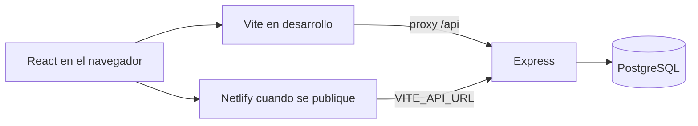

# Plan técnico

Cómo se construye la especificación. Si este plan y `spec.md` disienten en comportamiento, manda la spec. Si disienten en estructura, manda este plan.

## 1. Arquitectura

Un navegador React habla con una API Express. La API es la única que aplica las reglas y escribe en PostgreSQL. No hay workers, colas ni servicios extra.



En local la base sale de `docker-compose.yml`. En el despliegue previsto, la base es Neon, la API es Render y el estático es Netlify. Ese despliegue todavía no está hecho.

Procesos:

| Proceso | Puerto local | Responsabilidad |
| --- | --- | --- |
| Vite | 5173 | Interfaz. Proxea `/api` a la API. |
| Express | 4000 | HTTP, reglas, SQL. |
| PostgreSQL | 5432 | Datos y restricción de solape. |

## 2. Estructura prevista

```
backend/src/index.ts
backend/src/app.ts
backend/src/config.ts
backend/src/clock.ts
backend/src/db/pool.ts
backend/src/db/migrate.ts
backend/src/db/seed.ts
backend/src/middleware/auth.ts
backend/src/middleware/error.ts
backend/src/modules/auth/{router,service,repository}.ts
backend/src/modules/services/{router,service,repository}.ts
backend/src/modules/professionals/{router,service,repository}.ts
backend/src/modules/appointments/{router,service,repository}.ts
backend/src/modules/clients/{router,service,repository}.ts
backend/migrations/001_init.sql
backend/tests/helpers.ts
backend/tests/*.test.ts
frontend/src/main.tsx
frontend/src/App.tsx
frontend/src/api.ts
frontend/src/auth.tsx
frontend/src/pages/*.tsx
frontend/src/styles.css
frontend/tests/*.test.tsx
```

Esos archivos de aplicación todavía no existen. Los crea la tarea que los necesita.

## 3. Modelo de datos

Extensiones: `citext` y `btree_gist`.

```sql
CREATE TYPE user_role AS ENUM ('cliente', 'profesional', 'administrador');
CREATE TYPE appointment_status AS ENUM ('reservado', 'cancelado', 'completado', 'ausente');

CREATE TABLE users (
  id uuid PRIMARY KEY DEFAULT gen_random_uuid(),
  email citext NOT NULL UNIQUE,
  password_hash text NOT NULL,
  name text NOT NULL,
  phone text,
  role user_role NOT NULL,
  active boolean NOT NULL DEFAULT true,
  created_at timestamptz NOT NULL DEFAULT now(),
  CONSTRAINT users_name_len CHECK (char_length(name) BETWEEN 2 AND 80),
  CONSTRAINT users_phone_len CHECK (phone IS NULL OR char_length(phone) <= 30)
);

CREATE TABLE services (
  id uuid PRIMARY KEY DEFAULT gen_random_uuid(),
  name text NOT NULL,
  description text NOT NULL DEFAULT '',
  duration_minutes integer NOT NULL,
  price_cents integer NOT NULL,
  active boolean NOT NULL DEFAULT true,
  created_at timestamptz NOT NULL DEFAULT now(),
  CONSTRAINT services_duration CHECK (
    duration_minutes BETWEEN 15 AND 240 AND duration_minutes % 15 = 0
  ),
  CONSTRAINT services_price CHECK (price_cents >= 0),
  CONSTRAINT services_name_len CHECK (char_length(name) BETWEEN 2 AND 80)
);

CREATE TABLE professionals (
  id uuid PRIMARY KEY DEFAULT gen_random_uuid(),
  user_id uuid NOT NULL UNIQUE REFERENCES users (id),
  bio text NOT NULL DEFAULT '',
  active boolean NOT NULL DEFAULT true,
  created_at timestamptz NOT NULL DEFAULT now()
);

CREATE TABLE professional_schedules (
  id uuid PRIMARY KEY DEFAULT gen_random_uuid(),
  professional_id uuid NOT NULL REFERENCES professionals (id) ON DELETE CASCADE,
  weekday smallint NOT NULL,
  start_time time NOT NULL,
  end_time time NOT NULL,
  CONSTRAINT schedule_weekday CHECK (weekday BETWEEN 1 AND 7),
  CONSTRAINT schedule_time CHECK (end_time > start_time),
  CONSTRAINT schedule_unique UNIQUE (professional_id, weekday)
);

CREATE TABLE time_blocks (
  id uuid PRIMARY KEY DEFAULT gen_random_uuid(),
  professional_id uuid NOT NULL REFERENCES professionals (id),
  start_at timestamptz NOT NULL,
  end_at timestamptz NOT NULL,
  reason text NOT NULL DEFAULT '',
  created_by uuid NOT NULL REFERENCES users (id),
  created_at timestamptz NOT NULL DEFAULT now(),
  CONSTRAINT blocks_range CHECK (end_at > start_at)
);

CREATE TABLE appointments (
  id uuid PRIMARY KEY DEFAULT gen_random_uuid(),
  client_id uuid NOT NULL REFERENCES users (id),
  professional_id uuid NOT NULL REFERENCES professionals (id),
  service_id uuid NOT NULL REFERENCES services (id),
  start_at timestamptz NOT NULL,
  end_at timestamptz NOT NULL,
  status appointment_status NOT NULL DEFAULT 'reservado',
  price_cents integer NOT NULL,
  duration_minutes integer NOT NULL,
  cancelled_at timestamptz,
  cancel_reason text,
  created_at timestamptz NOT NULL DEFAULT now(),
  CONSTRAINT appointments_range CHECK (end_at > start_at),
  CONSTRAINT appointments_duration CHECK (duration_minutes BETWEEN 15 AND 240)
);

CREATE INDEX appointments_professional_start_idx ON appointments (professional_id, start_at);
CREATE INDEX appointments_client_start_idx ON appointments (client_id, start_at);
CREATE INDEX time_blocks_professional_start_idx ON time_blocks (professional_id, start_at);

ALTER TABLE appointments
  ADD CONSTRAINT appointments_no_overlap
  EXCLUDE USING gist (
    professional_id WITH =,
    tstzrange(start_at, end_at, '[)') WITH &&
  )
  WHERE (status = 'reservado');
```

`schema_migrations (filename text primary key, applied_at timestamptz)` la crea el script de migración antes de aplicar `001_init.sql`.

## 4. Dónde se aplica cada regla

| Regla | Servicio | Base | Prueba |
| --- | --- | --- | --- |
| RN1 | Comparar `startAt` con el reloj antes de insertar. | No hay `CHECK` con `now()`: PostgreSQL no lo permite ahí. | CP-20 |
| RN2 | Buscar turnos `reservado` que crucen el rango, con la fila del profesional bloqueada. | `appointments_no_overlap`. Traducir `23P01` a `OVERLAP`. | CP-25, CP-26, CP-27 |
| RN3 | Copiar duración y precio. Calcular `endAt` en el servidor. Ignorar duración o precio que mande el cliente. | Columnas `NOT NULL` del turno. | CP-19 |
| RN4 | Pasar inicio y fin a la zona del local, buscar el tramo de ese `weekday` y exigir que el turno quede adentro. | `schedule_time`, `schedule_weekday`, unicidad del día. | CP-13, CP-14 |
| RN5 | Misma transacción y el mismo `FOR UPDATE`. Rechazar cruce en los dos sentidos. | `blocks_range`. El cruce con turnos no entra en el `EXCLUDE` porque es otra tabla: lo garantiza el candado. | CP-15, CP-16 |
| RN6 | Rechazar la reserva si usuario o ficha están inactivos. Al desactivar, actualizar las dos filas en una transacción. | Dos booleanos. | CP-12 |
| RN7 | Según el rol, comparar 24 horas con el reloj o rechazar al profesional. | El estado deja de ser `reservado` y el `EXCLUDE` deja de cubrirlo, así el hueco se libera. | CP-30 a CP-34 |
| RN8 | `BEGIN`, `FOR UPDATE` del profesional, lecturas, `INSERT`, `COMMIT`. | Restricción de exclusión como red de fondo. | CP-27 |
| RN9 | Tabla de transiciones en el servicio de turnos. No hay `UPDATE` libre del estado. | Enum de cuatro valores. | CP-38 |
| RN10 | Rol titular y `startAt <= reloj`. | Ninguna adicional. | CP-35, CP-36, CP-37 |
| RN11 | El servicio de registro fuerza `cliente`. | El enum no se puede saltar desde un cliente SQL inyectado por este flujo: el valor lo pone el servidor. | CP-01 |
| RN12 | Filtros obligatorios en los repositorios de listado y chequeo de titular en cada comando. | No se delega a una policy de base. | CP-10, CP-17, CP-28, CP-29, CP-34, CP-39, CP-41 |
| RN13 | Validar el inicio en hora local y la duración al guardar el servicio. | `services_duration`. | CP-09, CP-18, CP-24 |
| RN14 | Comparar el día local del inicio con hoy y hoy + 30, usando el reloj. | Ninguna. | CP-23 |
| RN15 | Zod, `lower(email)`, bcrypt. Mensaje único de login. | `citext` único. | CP-02, CP-03, CP-05 |
| RN16 | Alta de turno y catálogo público filtran `active`. | Booleano, sin borrado. | CP-07, CP-08, CP-21 |
| RN17 | Login y reserva leen `users.active`. | Booleano. | CP-06, CP-22, CP-40 |

Algoritmo de reserva, en una sola transacción:

1. Tomar la fila de `professionals` con `FOR UPDATE`.
2. Cargar servicio, cliente, usuario del profesional y tramo del día.
3. Rechazar según RN1, RN3, RN4, RN6, RN13, RN14, RN16 y RN17.
4. Buscar un turno `reservado` o un bloqueo que cruce `[start, end)`.
5. Insertar. Si la base devuelve `23P01`, responder `OVERLAP`.

El alta de bloqueo usa los pasos 1, 4 y el insert en `time_blocks`, más las validaciones de RN5.

## 5. Disponibilidad

Para un `professionalId`, un `serviceId` y un `date` local:

1. Si el profesional o el servicio no existen o están inactivos, lista vacía o 404 según la spec.
2. Si `date` es anterior a hoy o posterior a hoy + 30 en la zona del local, lista vacía.
3. Si ese `weekday` no tiene tramo, lista vacía.
4. Generar inicios desde `start_time` inclusive hasta `end_time - duración` inclusive, cada 15 minutos.
5. Quitar un inicio si `start <= reloj`, si el turno se sale del tramo, si cruza un `reservado` o si cruza un bloqueo.
6. Devolver los inicios en ISO-8601 UTC.

La reserva vuelve a comprobar todo. La disponibilidad no reserva.

## 6. Autenticación

`config.ts` lee el entorno y corta el proceso si faltan `DATABASE_URL` o `JWT_SECRET`. El JWT firma `{ sub, role }` y vence a las 8 horas. El middleware carga el usuario vivo: si fue desactivado después de emitir el token, responde 401.

Contraseñas con `bcryptjs`, costo 10. Helmet y CORS con `CORS_ORIGIN`. `express.json` con límite de 16 kb.

## 7. Pantallas

Textos en español. Sin biblioteca visual. Una hoja CSS.

| Ruta | Quién | Qué hace |
| --- | --- | --- |
| `/` | Público | Servicios activos y acceso a reservar. |
| `/registro` | Público | HU-01. |
| `/ingreso` | Público | HU-02. |
| `/reservar` | Cliente autenticado | Elige servicio, profesional, día y un inicio devuelto por la API. Envía `POST /api/appointments`. Muestra el `message` de error. |
| `/mis-turnos` | Cliente | Lista y cancela. Si el servidor responde `LATE_CANCEL`, muestra ese mensaje. |
| `/agenda` | Profesional | Turnos propios, formulario de horario semanal y bloqueos. |
| `/admin` | Administrador | Cuatro secciones simples en la misma ruta: servicios, profesionales, clientes y turnos. |

Una ruta privada sin sesión redirige a `/ingreso`. Una ruta de otro rol muestra que no tiene permiso, sin llamar a mutaciones.

## 8. Pruebas

`tests/helpers.ts` aplica migraciones a `DATABASE_URL_TEST`, trunca `appointments`, `time_blocks`, `professional_schedules`, `professionals`, `services` y `users` antes de cada caso, y exporta la app y un reloj fijo.

Los CP de la spec se agrupan en archivos por tarea (`auth.test.ts`, `services.test.ts`, `appointments.test.ts`, y los que indique `tasks.md`). CP-27 dispara dos `POST` con `Promise.all`.

En el frontend, las pruebas de T15 y T16 mockean `fetch` para ver que se pinta un slot y que se muestra el mensaje `OVERLAP` o `LATE_CANCEL`. Eso no sustituye los CP de API.

## 9. Entornos

| Variable | Uso |
| --- | --- |
| `DATABASE_URL` | API y migraciones. |
| `DATABASE_URL_TEST` | Vitest. |
| `JWT_SECRET` | Firma. |
| `PORT` | Por defecto 4000. |
| `CORS_ORIGIN` | Origen permitido. |
| `ADMIN_EMAIL`, `ADMIN_NAME`, `ADMIN_PASSWORD` | Semilla del administrador. |
| `DEMO_PASSWORD` | Opcional. Datos de la sección 7 de la spec. |
| `VITE_API_URL` | Vacío en local. URL de Render cuando exista el despliegue. |

La base de prueba se crea una vez con la misma imagen Docker: `CREATE DATABASE studio_capilar_test`. El usuario `studio` del compose es superusuario local y puede crearla. Esa contraseña no se reutiliza en Neon.

## 10. Publicación prevista

1. Crear la base en Neon y correr las migraciones con su `DATABASE_URL`.
2. Crear el servicio web en Render apuntando a `backend`, con las variables de la tabla, `CORS_ORIGIN` en la URL de Netlify y `JWT_SECRET` nuevo.
3. Crear el sitio en Netlify apuntando a `frontend`, con `VITE_API_URL` en la URL de Render.
4. Correr la semilla contra la base de Neon.
5. Recién entonces escribir las dos URLs en el README.

Hasta que esos pasos no se hagan, el README dice que no hay versión publicada.

## 11. Orden de construcción

El orden y el criterio de cierre están en `tasks.md`. Resumen de dependencias:

`T01` herramientas → `T02` esquema → `T03` cuentas → `T04` servicios y `T05` profesionales → `T06` bloqueos → `T07` disponibilidad → `T08` reserva → `T09` consulta → `T10` cancelación → `T11` cierre → `T12` clientes → `T13` semilla. El frontend `T14` espera `T03`; `T15` espera `T08`; `T16` espera `T10`; `T17` espera `T06` y `T11`; `T18` espera `T12`. `T19` deja los pasos de publicación escritos, sin marcarlos como realizados.
