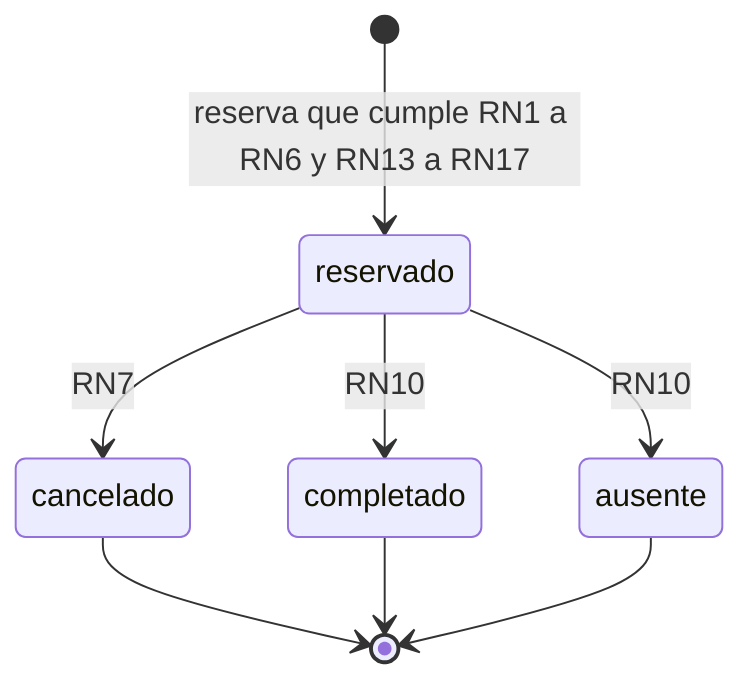

# Especificación v1

Studio Capilar gestiona los turnos de una peluquería. Esta especificación está cerrada: un implementador no tiene que elegir reglas, estados ni contratos.

Documentos que la acompañan: `glosario.md` (vocabulario), `decisiones.md` (por qué), `plan.md` (cómo está armado), `tasks.md` (en qué orden se construye).

## 1. Alcance

Entra: registro e ingreso, tres roles, catálogo, horario semanal, bloqueos, disponibilidad, reserva, consulta, cancelación, cierre del turno y administración.

No entra: lo listado en `preguntas-abiertas.md`.

Constantes fijas:

| Constante | Valor |
| --- | --- |
| Zona horaria | `America/Argentina/Buenos_Aires` |
| Moneda | ARS, guardada en centavos enteros |
| Grilla | 15 minutos |
| Horizonte | 30 días locales, inclusive |
| Anticipación de cancelación del cliente | 24 horas |
| Duración de un servicio | 15 a 240 minutos, múltiplo de 15 |
| JWT | 8 horas |
| Costo bcrypt | 10 |

## 2. Actores

| Rol (valor JSON) | Puede |
| --- | --- |
| `cliente` | Registrarse, ver catálogo y disponibilidad, reservar para sí, ver sus turnos, cancelar los suyos si RN7 lo permite. |
| `profesional` | Entrar, ver sus turnos, reemplazar su horario semanal, crear y borrar sus bloqueos futuros, marcar `completado` o `ausente` en sus turnos. |
| `administrador` | Todo lo anterior sobre cualquier profesional, más servicios, alta y baja lógica de profesionales y clientes, listado global de turnos y cancelación sin las 24 horas. |

El registro público ignora cualquier rol enviado y crea `cliente`. No existe un endpoint para crear administradores.

## 3. Reglas de negocio

**RN1. Sin fechas pasadas.** El inicio del turno debe ser estrictamente posterior al instante del reloj de la operación. El instante actual no es válido.

**RN2. Sin solapamiento.** Un profesional no puede tener dos turnos `reservado` cuyos intervalos `[inicio, fin)` se crucen. Tocarse en el extremo no es cruce: uno puede terminar a la misma hora en que otro empieza.

**RN3. La duración sale del servicio.** `fin = inicio + duration_minutes` del servicio en ese momento. El turno guarda copia de `duration_minutes` y `price_cents`. Un cambio posterior del catálogo no altera turnos ya creados. Quien reserva no envía duración ni precio.

**RN4. Dentro del horario laboral.** El intervalo completo del turno cae dentro del único tramo de ese día de la semana, en la zona del local. El día se numera ISO: 1 lunes … 7 domingo. Un día sin tramo está cerrado. El turno no cruza la medianoche. El fin del tramo es exclusive: con horario 09:00–18:00 y 45 minutos, el último inicio es 17:15.

**RN5. Bloqueos.** Un profesional o un administrador puede crear un bloqueo futuro `[inicio, fin)`. No se puede reservar encima de un bloqueo, ni crear un bloqueo encima de un turno `reservado`. Los bloqueos también usan intervalos semiabiertos. El fin debe ser posterior al inicio y el fin debe ser futuro. Duración mínima: 15 minutos.

**RN6. Profesional inactivo.** No se reserva con un profesional cuyo usuario o cuya ficha estén inactivos. Desactivarlo pone las dos marcas en falso y le impide ingresar. Reactivarlo pone las dos en verdadero. Sus turnos históricos se conservan.

**RN7. Cancelación.** Solo desde `reservado`. El cliente cancela únicamente un turno suyo cuando `inicio - ahora >= 24 horas`. Exactamente 24 horas es válido. El administrador cancela cualquier `reservado` sin esa anticipación. El profesional no cancela. Cancelar guarda `cancelled_at` y un motivo opcional, y pasa el estado a `cancelado`. Ese turno deja de ocupar agenda.

**RN8. Concurrencia.** La prevención de RN2 y del cruce entre reserva y bloqueo (RN5) vale ante solicitudes simultáneas. No alcanza con deshabilitar un botón. La transacción bloquea la fila del profesional y la base rechaza dos `reservado` solapados del mismo profesional aunque el servicio se equivoque.

**RN9. Estados.** Los estados son `reservado`, `cancelado`, `completado` y `ausente`. Solo `reservado` ocupa agenda. `cancelado`, `completado` y `ausente` son finales: no hay transición de salida.

**RN10. Cierre.** Pasar a `completado` o a `ausente` lo hace el profesional de ese turno o un administrador, solo desde `reservado` y solo si el inicio ya es anterior o igual al reloj de la operación. Antes del inicio, ambos rechazan.

**RN11. Alta pública.** `POST /api/auth/register` crea solamente `cliente`. Un campo `role` en el cuerpo se ignora.

**RN12. Alcance de datos.** El cliente solo ve y cancela sus turnos. El profesional solo ve su agenda, su horario, sus bloqueos y sus turnos, y solo cierra los suyos. El administrador ve y opera todo el local. La disponibilidad pública no incluye el nombre de otros clientes ni el detalle de los bloqueos.

**RN13. Grilla.** El inicio, expresado en la zona del local, tiene minuto 00, 15, 30 o 45, y segundos y milisegundos en 0. La duración del servicio es múltiplo de 15.

**RN14. Horizonte.** El día local del inicio es hoy o posterior, y no pasa de hoy + 30 días. Además rige RN1 sobre el instante.

**RN15. Credenciales.** El email es único sin distinguir mayúsculas. Se guarda en minúsculas. La contraseña tiene al menos 8 caracteres, una letra y un número, y solo se persiste el hash. El login fallido, el usuario inexistente y el usuario inactivo responden el mismo mensaje: «Credenciales inválidas».

**RN16. Servicio inactivo.** Un servicio inactivo no aparece en el catálogo público y no admite reservas nuevas. No se borra físicamente.

**RN17. Cliente inactivo.** Un usuario inactivo no inicia sesión. Un cliente inactivo no puede reservar. Desactivar un cliente pone `users.active` en falso.

### Máquina de estados



No hay otras transiciones.

### Horario inicial del profesional

Al crearlo: lunes a viernes 09:00–18:00 y sábado 09:00–13:00. Domingo cerrado. Reemplazar el horario pisa todas las filas de esa persona. La lista nueva puede dejar días cerrados. Cada día aparece como máximo una vez y `end_time` es posterior a `start_time`.

## 4. API

Prefijo `/api`. JSON. Fechas absolutas en ISO-8601. Fechas de calendario en `YYYY-MM-DD`. Horas de tramo en `HH:mm`.

Error:

```json
{ "error": { "code": "OVERLAP", "message": "Ese horario ya está ocupado." } }
```

| Situación | HTTP | `code` |
| --- | --- | --- |
| Cuerpo inválido | 400 | `VALIDATION_ERROR` |
| Sin token o token vencido | 401 | `UNAUTHORIZED` |
| Login fallido | 401 | `INVALID_CREDENTIALS` |
| Rol o titular incorrecto | 403 | `FORBIDDEN` |
| Recurso inexistente | 404 | `NOT_FOUND` |
| Email repetido | 409 | `EMAIL_TAKEN` |
| Solape de turno o bloqueo | 409 | `OVERLAP` |
| Inicio no futuro | 422 | `PAST_DATE` |
| Fuera de horario o día cerrado | 422 | `OUTSIDE_WORKING_HOURS` |
| Profesional, usuario o cliente inactivo | 422 | `INACTIVE` |
| Servicio inactivo | 422 | `INACTIVE_SERVICE` |
| Cancelación tardía | 422 | `LATE_CANCEL` |
| Transición ilegal | 422 | `INVALID_TRANSITION` |
| Fuera de grilla | 422 | `INVALID_SLOT` |
| Fuera de horizonte | 422 | `OUTSIDE_HORIZON` |
| Bloqueo inválido | 422 | `INVALID_BLOCK` |

### Auth

`POST /api/auth/register` público. Cuerpo: `{ "name", "email", "password", "phone"? }`. `name` de 2 a 80 caracteres. `phone` opcional, hasta 30. Respuesta 201: `{ "token", "user" }`. `user` incluye `id`, `name`, `email`, `role`, `phone`.

`POST /api/auth/login` público. Cuerpo: `{ "email", "password" }`. Respuesta 200 con la misma forma.

`GET /api/auth/me` autenticado. Devuelve `user`.

### Servicios

`GET /api/services` público. Solo activos. Cada ítem: `id`, `name`, `description`, `durationMinutes`, `priceCents`, `active`.

`GET /api/services?includeInactive=true` solo administrador. Incluye inactivos.

`POST /api/services` administrador. Cuerpo: `name`, `description`, `durationMinutes`, `priceCents`. `priceCents` es entero `>= 0`. Queda activo. Respuesta 201.

`PATCH /api/services/:id` administrador. Puede cambiar nombre, descripción, duración, precio y `active`.

### Profesionales

`GET /api/professionals` público. Solo activos. Ítems: `id`, `name`, `bio`.

`GET /api/professionals?includeInactive=true` solo administrador.

`GET /api/professionals/:id` público si está activo. Devuelve `id`, `name`, `bio`, `active` y `schedule` (`weekday`, `startTime`, `endTime`). Si está inactivo, el público recibe 404. El administrador lo ve igual. Email y teléfono solo para el administrador.

`POST /api/professionals` administrador. Cuerpo: `name`, `email`, `password`, `phone` opcional, `bio` opcional. Crea usuario `profesional`, ficha activa y horario inicial. Respuesta 201 con la ficha.

`PATCH /api/professionals/:id` administrador. Puede cambiar `name`, `phone`, `bio` y `active`. `active` mueve las dos marcas (RN6).

`PUT /api/professionals/:id/schedule` administrador o ese profesional. Cuerpo: `{ "days": [{ "weekday", "startTime", "endTime" }] }`. Reemplaza la semana completa. Lista vacía deja la semana cerrada.

### Bloqueos

`GET /api/professionals/:id/blocks?from&to` administrador o ese profesional. `from` y `to` son ISO-8601. Devuelve bloqueos que cruzan ese rango.

`POST /api/professionals/:id/blocks` administrador o ese profesional. Cuerpo: `{ "startAt", "endAt", "reason"? }`. Respuesta 201.

`DELETE /api/professionals/:id/blocks/:blockId` administrador o ese profesional. Solo si el fin del bloqueo es futuro. Respuesta 204.

### Disponibilidad

`GET /api/professionals/:id/availability?serviceId&date` público. `date` es `YYYY-MM-DD` en el local. Respuesta: `{ "slots": ["<ISO-8601>", ...] }` con inicios válidos para reservar ese servicio ese día. Lista vacía si el día está cerrado, el servicio no entra, el profesional o el servicio están inactivos, o la fecha cae fuera del horizonte. Fecha mal formada: 400. Profesional inexistente o inactivo para el público: 404.

### Turnos

`POST /api/appointments` cliente o administrador. Cuerpo: `{ "professionalId", "serviceId", "startAt", "clientId"? }`. El cliente reserva para sí y no puede enviar otro `clientId`. El administrador debe enviar `clientId`. Respuesta 201 con el turno: `id`, `clientId`, `professionalId`, `serviceId`, `startAt`, `endAt`, `status`, `priceCents`, `durationMinutes`.

`GET /api/appointments?from&to&status` autenticado. El cliente queda filtrado a los suyos. El profesional, a los de su ficha. El administrador ve todos y puede agregar `clientId` y `professionalId`. Orden por `startAt` ascendente. Sin `from` y `to`, devuelve desde el inicio del día local de hoy hasta 30 días después.

`GET /api/appointments/:id` autenticado, si RN12 lo permite.

`POST /api/appointments/:id/cancel` cliente titular o administrador. Cuerpo opcional: `{ "reason" }`.

`POST /api/appointments/:id/complete` profesional titular o administrador.

`POST /api/appointments/:id/no-show` profesional titular o administrador. Deja el estado en `ausente`.

### Clientes

`GET /api/clients?includeInactive=true|false` administrador. Usuarios con rol `cliente`. Por defecto solo activos. Ítems: `id`, `name`, `email`, `phone`, `active`.

`PATCH /api/clients/:id` administrador. Puede cambiar `name`, `phone` y `active`.

### Salud

`GET /api/health` público. Respuesta 200: `{ "ok": true }`. No toca la base.

## 5. Historias y criterios

Cada criterio es un caso de prueba. El id `CP` es el nombre que debe aparecer en el test.

### HU-01 Registrarse

Como visitante, quiero crear una cuenta de cliente para poder reservar.

**CP-01.** Registro válido. Cubre RN11 y RN15.
Dado un email no usado y la contraseña `clave1234`.
Cuando envía nombre, email y contraseña, aunque mande `role: administrador`.
Entonces la respuesta es 201, el rol es `cliente` y `GET /api/auth/me` con ese token devuelve el mismo usuario.

**CP-02.** Email repetido. Cubre RN15.
Dado un cliente ya registrado con ese email en otras mayúsculas.
Cuando se registra de nuevo.
Entonces la respuesta es 409 `EMAIL_TAKEN` y sigue habiendo un solo usuario.

**CP-03.** Contraseña débil. Cubre RN15.
Dado la contraseña `12345678`.
Cuando se registra.
Entonces la respuesta es 400 `VALIDATION_ERROR` y no se crea el usuario.

### HU-02 Ingresar

Como usuario activo, quiero entrar para operar según mi rol.

**CP-04.** Ingreso válido.
Dado un cliente activo.
Cuando envía su email y contraseña.
Entonces recibe 200 y un token que `GET /api/auth/me` acepta.

**CP-05.** Credenciales incorrectas. Cubre RN15.
Dado un email inexistente, o uno existente con clave mala.
Cuando intenta entrar.
Entonces ambas respuestas son 401 `INVALID_CREDENTIALS` con el mismo mensaje.

**CP-06.** Usuario inactivo. Cubre RN17.
Dado un cliente desactivado.
Cuando intenta entrar con su clave real.
Entonces la respuesta es 401 `INVALID_CREDENTIALS`.

### HU-03 Ver el catálogo

Como visitante, quiero ver los servicios vigentes, su duración y su precio.

**CP-07.** Catálogo público. Cubre RN16.
Dado un servicio activo y otro inactivo.
Cuando consulta `GET /api/services` sin token.
Entonces solo aparece el activo, con duración y precio en centavos.

### HU-04 Administrar servicios

Como administrador, quiero crear y desactivar servicios para que el catálogo refleje lo que la peluquería ofrece.

**CP-08.** Alta y baja lógica. Cubre RN16.
Dado un administrador autenticado.
Cuando crea «Corte» de 45 minutos y 1.500.000 centavos, y después lo marca inactivo.
Entonces el alta responde 201 y el servicio deja de verse en el catálogo público.

**CP-09.** Duración ilegal. Cubre RN13.
Dado un administrador.
Cuando crea un servicio de 20 minutos.
Entonces la respuesta es 400 y no se guarda.

**CP-10.** Un cliente no administra. Cubre RN12.
Dado un cliente autenticado.
Cuando hace `POST /api/services`.
Entonces la respuesta es 403 `FORBIDDEN`.

### HU-05 Administrar profesionales

Como administrador, quiero dar de alta profesionales con un horario inicial para que puedan recibir turnos.

**CP-11.** Alta con horario inicial.
Dado un administrador.
Cuando crea un profesional con email nuevo y contraseña válida.
Entonces existen el usuario `profesional`, la ficha activa y los tramos de lunes a sábado definidos en esta spec. Domingo no tiene tramo.

**CP-12.** Desactivar profesional. Cubre RN6.
Dado un profesional activo.
Cuando el administrador lo desactiva.
Entonces ya no puede ingresar, desaparece del listado público y una reserva con él responde 422 `INACTIVE`.

### HU-06 Definir la agenda semanal

Como profesional, quiero fijar mi horario para que solo se reserve cuando trabajo.

**CP-13.** Reemplazo de horario. Cubre RN4.
Dado un profesional que deja únicamente el martes de 10:00 a 14:00.
Cuando un cliente pide disponibilidad de un servicio de 60 minutos un martes dentro del horizonte.
Entonces los inicios van de 10:00 a 13:00 inclusive, en grilla de 15, y un miércoles devuelve lista vacía.

**CP-14.** Fuera de horario. Cubre RN4.
Dado ese mismo horario.
Cuando reserva un martes a las 13:15 un servicio de 60 minutos.
Entonces la respuesta es 422 `OUTSIDE_WORKING_HOURS` y no hay turno.

### HU-07 Bloquear horarios

Como profesional, quiero bloquear un intervalo para que nadie reserve mientras no atiendo.

**CP-15.** El bloqueo saca huecos. Cubre RN5.
Dado un bloqueo que cruza parte de la tarde laboral.
Cuando se consulta la disponibilidad de ese día.
Entonces ningún inicio ofrecido produce un turno que cruce el bloqueo.

**CP-16.** No se bloquea encima de un turno. Cubre RN5.
Dado un turno `reservado`.
Cuando el profesional crea un bloqueo que lo cruza.
Entonces la respuesta es 409 `OVERLAP` y el bloqueo no existe.

**CP-17.** Un cliente no crea bloqueos. Cubre RN12.
Dado un cliente.
Cuando hace `POST` de un bloqueo.
Entonces la respuesta es 403.

### HU-08 Consultar disponibilidad

Como cliente, quiero ver horarios de inicio reales antes de reservar.

**CP-18.** La lista respeta ocupación y grilla. Cubre RN2, RN3, RN12 y RN13.
Dado un turno `reservado` de 10:00 a 10:45 y un servicio de 30 minutos en un día de 09:00 a 13:00.
Cuando consulta la disponibilidad.
Entonces no aparece un inicio cuyo intervalo cruce `[10:00, 10:45)`, sí puede aparecer 10:45, y todos los inicios caen en la grilla.

### HU-09 Reservar

Como cliente, quiero reservar un servicio con un profesional en un horario libre.

**CP-19.** Reserva válida. Cubre RN3.
Dado profesional activo, servicio activo de 45 minutos y 900.000 centavos, e inicio futuro alineado y libre.
Cuando el cliente reserva sin enviar precio ni duración.
Entonces el turno queda `reservado`, el fin es inicio más 45 minutos y el turno guarda 900.000 centavos y 45 minutos.

**CP-20.** Fecha pasada. Cubre RN1.
Dado un inicio anterior al reloj de la prueba.
Cuando reserva.
Entonces la respuesta es 422 `PAST_DATE` y no se crea el turno.

**CP-21.** Servicio inactivo. Cubre RN16.
Dado un servicio desactivado.
Cuando reserva ese servicio.
Entonces la respuesta es 422 `INACTIVE_SERVICE`.

**CP-22.** Cliente inactivo. Cubre RN17.
Dado un cliente desactivado y un administrador que reserva para ese `clientId`.
Cuando envía la reserva.
Entonces la respuesta es 422 `INACTIVE`.

**CP-23.** Fuera de horizonte. Cubre RN14.
Dado un inicio en el día local de hoy + 31 días, alineado y dentro del horario.
Cuando reserva.
Entonces la respuesta es 422 `OUTSIDE_HORIZON`.

**CP-24.** Fuera de grilla. Cubre RN13.
Dado un inicio a las 10:10.
Cuando reserva.
Entonces la respuesta es 422 `INVALID_SLOT`.

**CP-25.** Solape. Cubre RN2.
Dado un turno `reservado` de 10:00 a 11:00.
Cuando otro cliente reserva 10:30 para un servicio de 30 minutos con el mismo profesional.
Entonces la respuesta es 409 `OVERLAP`.

**CP-26.** El contacto no es solape. Cubre RN2.
Dado un turno de 10:00 a 11:00.
Cuando otro cliente reserva a las 11:00.
Entonces la respuesta es 201.

**CP-27.** Dos reservas simultáneas. Cubre RN2 y RN8.
Dado un horario libre.
Cuando dos clientes envían a la vez la misma reserva para ese profesional.
Entonces una respuesta es 201, la otra es 409 `OVERLAP` y queda un solo turno `reservado`.

**CP-28.** El cliente no reserva para otro. Cubre RN12.
Dado un cliente.
Cuando envía el `clientId` de otra persona.
Entonces la respuesta es 403 y el turno, si se crea por omitir ese campo, queda a su nombre. La prueba envía el campo y espera 403 sin turno nuevo.

### HU-10 Consultar turnos

Como usuario, quiero ver los turnos de mi alcance.

**CP-29.** Cada rol ve lo suyo. Cubre RN12.
Dado un turno del cliente A con el profesional P y otro de B con P.
Cuando A, P y el administrador listan turnos.
Entonces A ve solo el suyo, P ve los dos de su agenda y no ve un turno de otro profesional, y el administrador ve todos.

### HU-11 Cancelar

Como cliente, quiero cancelar con anticipación. Como administrador, quiero poder cancelar igual si la peluquería debe cerrar ese turno.

**CP-30.** Cancelación a tiempo. Cubre RN7.
Dado un turno propio que empieza en 24 horas exactas según el reloj de la prueba.
Cuando el cliente lo cancela.
Entonces queda `cancelado` y ese horario vuelve a aparecer en la disponibilidad.

**CP-31.** Cancelación tardía. Cubre RN7.
Dado un turno propio que empieza en 23 horas y 59 minutos.
Cuando el cliente lo cancela.
Entonces la respuesta es 422 `LATE_CANCEL` y sigue `reservado`.

**CP-32.** El administrador cancela tarde. Cubre RN7.
Dado un turno que empieza en una hora.
Cuando el administrador lo cancela.
Entonces queda `cancelado`.

**CP-33.** El profesional no cancela. Cubre RN7.
Dado el profesional de ese turno.
Cuando llama a cancelar.
Entonces la respuesta es 403 y el turno sigue `reservado`.

**CP-34.** No se cancela un turno ajeno. Cubre RN12.
Dado un cliente que no es el titular.
Cuando lo cancela.
Entonces la respuesta es 403.

### HU-12 Cerrar el turno

Como profesional, quiero marcar si la persona vino o no, una vez llegado el horario.

**CP-35.** Completar desde el inicio. Cubre RN10.
Dado un turno `reservado` cuyo inicio es anterior o exactamente igual al reloj de la prueba.
Cuando el profesional lo completa.
Entonces queda `completado`. El caso de igualdad forma parte de esta prueba.

**CP-36.** Cerrar antes de tiempo. Cubre RN10.
Dado un turno que todavía no empezó.
Cuando el profesional lo completa o lo marca ausente.
Entonces ambas respuestas son 422 `INVALID_TRANSITION` y sigue `reservado`.

**CP-37.** Ausente. Cubre RN10.
Dado un turno ya iniciado.
Cuando el profesional llama a no-show.
Entonces queda `ausente`.

**CP-38.** Estado final. Cubre RN9.
Dado un turno `cancelado`.
Cuando el administrador intenta completarlo.
Entonces la respuesta es 422 `INVALID_TRANSITION`.

**CP-39.** Otro profesional no cierra. Cubre RN12.
Dado un profesional que no es el del turno.
Cuando intenta completarlo.
Entonces la respuesta es 403.

### HU-13 Administrar clientes

Como administrador, quiero ver clientes y desactivar una cuenta.

**CP-40.** Listado y baja. Cubre RN17.
Dado dos clientes, uno de ellos a desactivar.
Cuando el administrador lista activos y luego desactiva a uno.
Entonces el desactivado no aparece en el listado por defecto y no puede ingresar.

**CP-41.** Un cliente no lista clientes. Cubre RN12.
Dado un cliente.
Cuando llama a `GET /api/clients`.
Entonces la respuesta es 403.

## 6. Matriz de trazabilidad

| Historia | Reglas | Casos | Tarea que los cubre |
| --- | --- | --- | --- |
| HU-01 | RN11, RN15 | CP-01 a CP-03 | T03 |
| HU-02 | RN15, RN17 | CP-04 a CP-06 | T03 |
| HU-03 | RN16 | CP-07 | T04 |
| HU-04 | RN12, RN13, RN16 | CP-08 a CP-10 | T04 |
| HU-05 | RN6 | CP-11, CP-12 | T05 |
| HU-06 | RN4 | CP-13, CP-14 | T05 guarda el horario; T07 cubre CP-13; T08 cubre CP-14 |
| HU-07 | RN5, RN12 | CP-15 a CP-17 | T06 cubre CP-16 y CP-17; T07 cubre CP-15 |
| HU-08 | RN2, RN3, RN12, RN13 | CP-18 | T07 |
| HU-09 | RN1, RN2, RN3, RN8, RN12, RN13, RN14, RN16, RN17 | CP-19 a CP-28 | T08 |
| HU-10 | RN12 | CP-29 | T09 |
| HU-11 | RN7, RN12 | CP-30 a CP-34 | T10 |
| HU-12 | RN9, RN10, RN12 | CP-35 a CP-39 | T11 |
| HU-13 | RN12, RN17 | CP-40, CP-41 | T12 |

RN4 también se observa en CP-13 y CP-14. RN8 se observa en CP-27. La interfaz de T14 a T18 no reemplaza estos casos: los repite solo donde la pantalla muestra el mensaje del servidor.

## 7. Semilla de demostración

Si `DEMO_PASSWORD` está definido, además del administrador se crean, solo cuando faltan, estos datos. Los precios son de ejemplo para la defensa, no una tarifa real relevada.

| Email | Rol | Notas |
| --- | --- | --- |
| `admin@studio-capilar.local` | administrador | Siempre, con `ADMIN_PASSWORD`. |
| `ana@studio-capilar.local` | profesional | Nombre «Ana Pérez». Horario inicial. |

| Servicio | Duración | Precio |
| --- | --- | --- |
| Corte clásico | 45 min | 1.500.000 centavos |
| Brushing | 30 min | 800.000 centavos |
| Coloración | 120 min | 4.500.000 centavos |

No se crean turnos de ejemplo. Así la agenda empieza vacía y las pruebas no dependen de la semilla.
